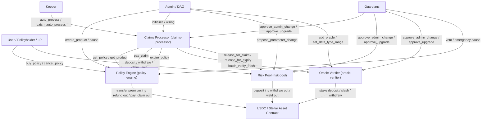

# Parashield Protocol Architecture

## Overview

Parashield is a decentralised parametric insurance protocol built on Stellar Soroban.
Unlike traditional insurance, claims are settled automatically by smart contracts
when a real-world trigger condition is confirmed by an oracle network.
No adjuster. No form. No delay.

## Contract Map

```
┌──────────────────────────────────────────────────────────┐
│                     User / DApp                          │
└────────────────────┬──────────────────────────────────────┘
                     │  buy_policy / submit_claim
                     ▼
┌──────────────────────────────────────────────────────────┐
│            Policy Engine (policy-engine)                 │
│  - Products catalogue (admin-defined)                    │
│  - Policy lifecycle: Active → Claimed / Expired          │
│  - Holds USDC escrow until payout or expiry              │
└──────┬──────────────────────────────────┬────────────────┘
       │ get_policy / pay_claim /         │ get_contract_balance
       │ expire_policy                    │
       ▼                                  ▼
┌─────────────────────┐         ┌─────────────────────────┐
│  Claims Processor   │         │     Risk Pool           │
│  (claims-processor) │         │     (risk-pool)         │
│                     │         │  - LP deposits USDC     │
│  - Evaluates oracle │         │  - Pool tokens (shares) │
│  - Calls pay_claim  │         │  - Yield from premiums  │
│    or expire_policy │         │  - Locks coverage cap.  │
└──────┬──────────────┘         └─────────────────────────┘
       │ verify_trigger
       ▼
┌──────────────────────────────────────────────────────────┐
│            Oracle Verifier (oracle-verifier)             │
│  - Multiple oracles submit signed observations           │
│  - Confidence-weighted median aggregation                │
│  - verify_trigger: returns bool for trigger condition    │
└──────────────────────────────────────────────────────────┘

         Admin / Token Holders
                  │
                  ▼
       ┌────────────────────┐
       │  Governance DAO    │
       │  (governance-dao)  │
       │  - Proposals       │
       │  - Token voting    │
       │  - Protocol params │
       └────────────────────┘
```

## Data Flow: Parametric Payout

```
1. Admin creates InsuranceProduct (oracle key, threshold, comparison)
2. User calls buy_policy(product_id, coverage_amount, duration_days, oracle_key)
   - Premium = coverage * premium_rate_bps / 10_000
   - USDC premium transferred from user to Policy Engine
   - Policy record created with status = Active
3. Oracle(s) submit data via oracle-verifier.submit_data() periodically
4. Keeper calls claims-processor.auto_process(policy_id)
   - Claims Processor calls oracle-verifier.verify_trigger(condition)
   - If trigger met:  Policy Engine.pay_claim() → USDC → policyholder
   - If trigger not met AND policy expired: Policy Engine.expire_policy()
```


## Cross-Contract Interactions

The protocol relies on synchronized interactions among five core smart contracts and Stellar Asset (token) contracts.

### Call Graph



### Cross-Contract Call Matrix

| Caller Contract | Callee Contract | Invoked Function | Purpose | Authorization Mechanism |
|---|---|---|---|---|
| `claims-processor` | `policy-engine` | `get_policy(policy_id)` | Read policy parameters, coverage amount, status, and claimant address | Public view function (`&env`) |
| `claims-processor` | `policy-engine` | `get_product(product_id)` | Read product configuration, oracle key, and trigger condition | Public view function (`&env`) |
| `claims-processor` | `policy-engine` | `pay_claim(caller, policy_id)` | Trigger USDC payout from policy escrow to policyholder | `require_claims_processor`: verifies `caller == StorageKey::ClaimsProcessor` |
| `claims-processor` | `policy-engine` | `expire_policy(caller, policy_id)` | Mark policy expired with no payout | `require_claims_processor`: verifies `caller == StorageKey::ClaimsProcessor` |
| `claims-processor` | `oracle-verifier` | `verify_trigger(data_type, key, condition)` | Check if condition is satisfied by aggregated oracle observations | Public view function (`&env`) |
| `claims-processor` | `oracle-verifier` | `verify_trigger_fresh(data_type, key, condition, max_age)` | Check trigger condition with strict max-age staleness enforcement | Public view function (`&env`) |
| `claims-processor` | `oracle-verifier` | `batch_verify_fresh(queries)` | Batch evaluate multiple triggers with freshness check | Public view function (`&env`) |
| `claims-processor` | `risk-pool` | `release_for_claim(caller, policy_id)` | Release earmarked pool liquidity upon claim settlement | `require_claims_processor`: verifies `caller == StorageKey::ClaimsProcessor` |
| `claims-processor` | `risk-pool` | `release_for_expiry(caller, policy_id)` | Free earmarked pool liquidity upon policy expiration | `require_claims_processor`: verifies `caller == StorageKey::ClaimsProcessor` |
| `policy-engine` | `token` (USDC) | `transfer(buyer, contract, premium)` | Pull insurance premium on policy purchase (`buy_policy`) | `buyer.require_auth()` |
| `policy-engine` | `token` (USDC) | `transfer(contract, policyholder, refund)` | Refund unearned premium upon policy cancellation (`cancel_policy`) | `policyholder.require_auth()` |
| `policy-engine` | `token` (USDC) | `transfer(contract, policyholder, coverage)` | Disburse claim settlement directly to policyholder (`pay_claim`) | Authorized via `claims_processor` |
| `risk-pool` | `token` (USDC) | `transfer(provider, contract, amount)` | Pull LP deposit capital into liquidity pool (`deposit`) | `provider.require_auth()` |
| `risk-pool` | `token` (USDC) | `transfer(contract, provider, amount)` | Return capital & yield on standard (`withdraw`) or emergency exit (`emergency_withdraw`) | `provider.require_auth()` + `admin.require_auth()` (emergency) |
| `risk-pool` | `token` (USDC) | `transfer(contract, provider, yield)` | Disburse accumulated yield (`claim_yield`, `pay_out_yield`) | `provider.require_auth()` |
| `risk-pool` | `token` (USDC) | `transfer(contract, destination, share)` | Route premium splits to Treasury / Backstop (`receive_premium`) | Caller authorization |
| `governance-dao` | Target Contract | `env.invoke_contract(target, function, args)` | Execute passed governance proposal following 2-day timelock | Passed DAO proposal voting threshold & quorum |

### Trust Assumptions

1. **Policy Engine trusts Claims Processor**: `policy-engine` delegates all payout decisions to `claims-processor`. Only `claims-processor` can invoke `pay_claim` or `expire_policy`. It assumes `claims-processor` faithfully validates oracle data before triggering payouts.
2. **Risk Pool trusts Claims Processor**: `risk-pool` allows `claims-processor` to atomically unlock capital (`release_for_claim` / `release_for_expiry`). It trusts that `claims-processor` only releases locks associated with valid policy resolutions.
3. **Claims Processor trusts Oracle Verifier**: `claims-processor` relies on `oracle-verifier`'s aggregation algorithm (median/mean/TWA) to prevent false positives and manipulation.
4. **All Contracts trust Token Implementation**: Contracts assume the underlying USDC token behaves strictly according to standard Stellar Asset / SEP-41 specifications (reverting on insufficient balance or failed transfer).
5. **Admin and Governance Transition**: Admin keys hold privileged parameters during initial phases. Protocol security assumes transition to `governance-dao` on mainnet, where SHIELD token holders govern protocol parameters subject to voting periods and execution timelocks.

### Failure Modes & Handling

- **Atomic Cross-Contract Reverts**: A failed external cross-contract call rolls back the entire transaction. In `claims-processor.auto_process`, if `policy_engine.pay_claim` succeeds but `risk_pool.release_for_claim` fails, the whole invocation reverts atomically, preventing partial execution or stranded capital.
- **Batch Isolation**: In `batch_auto_process` and `batch_submit_claims`, `claims-processor` uses `env.try_invoke_contract` sub-invocations to isolate individual failures. A single failing claim or policy does not abort processing of the remaining batch.
- **Stale or Missing Oracle Data**: If oracle readings are absent, `oracle-verifier` panics with `NoDataAvailable`. If readings exceed `staleness_threshold` (or `MAX_DATA_AGE`, default 7 days), calls fail with `StaleData`. In `auto_process`, this maps to `ClaimResult::OracleDataStale`, which consumes the cooldown to prevent keeper retry spam.
- **Pool Solvency & Liquidity Shortage**: `risk-pool` enforces that withdrawals cannot exceed unlocked available liquidity (`total_deposited.saturating_sub(total_locked)`). If liquidity is exhausted, redemption attempts revert with `Undercollateralized`.
- **Reentrancy Protection**: All fund-handling entry points in `risk-pool` (`deposit`, `withdraw`, `emergency_withdraw`, `transfer_position`, `claim_yield`, `receive_premium`) acquire a reentrancy guard (`ReentrancyGuard::enter(&env)`). Any recursive re-entrant call fails with `Error::Reentrancy` (`#47`).
- **Timelock Constraints**:
  - `ADMIN_TRANSFER_TIMELOCK`: 48 hours (`48 * 60 * 60` s) delay between proposing and accepting an admin transfer across all protocol contracts.
  - `ORACLE_CHANGE_TIMELOCK_SECONDS`: 48 hours delay before an oracle contract address change takes effect in `policy-engine`.
  - `ADMIN_ACTION_TIMELOCK_SECONDS`: 48 hours delay for sensitive admin actions in `policy-engine`.
  - `PARAMETER_TIMELOCK_SECONDS`: 2 days (`2 * 24 * 60 * 60` s) delay between proposing and executing risk pool parameter changes.
  - `TIMELOCK_SECONDS`: 7 days (`7 * 24 * 60 * 60` s) delay for admin emergency withdrawals in `risk-pool`.
  - `DEFAULT_CHALLENGE_PERIOD`: 7 days delay for oracle node stake withdrawal in `oracle-verifier`.
  - `Governance DAO`: 7-day voting period followed by a 2-day execution timelock for approved proposals.

### Access Control & Role Model

| Role | Controlled Functions / Powers | Role Management & Timelocks |
|---|---|---|
| **Admin** | Initialization, product catalogue management, contract wiring, pause/resume, parameter changes, guardian configuration, oracle registration. | Two-step transfer: `transfer_admin` starts `ADMIN_TRANSFER_TIMELOCK` (48 hours). Requires multisig guardian approval if `GuardianThreshold > 0`. Proposed admin calls `accept_admin` once timelock elapses. |
| **Guardian** | Critical safety approvals: multisig approval of admin changes, multisig approval of contract WASM upgrades, emergency pause veto in `policy-engine`. | Configured by Admin via `set_guardians(guardians, threshold)`. In `claims-processor`, changing guardian threshold requires current threshold approvals. |
| **Keeper** | Calling automated processing: `auto_process`, `batch_auto_process`, `process_claim`, `batch_process_claims`. Cannot alter parameters, withdraw funds, or change policy status manually. | Authorized by Admin via `add_keeper(keeper)` / `remove_keeper(keeper)`. Gated by `require_keeper` in `claims-processor`. Off-chain keeper bot scheduling cadence (e.g. hourly cron vs event listeners) is determined by deployment configuration *(to confirm)*. |
| **Policyholder / LP** | `buy_policy`, `cancel_policy`, `submit_claim`, `dispute_claim`, `deposit`, `withdraw`, `emergency_withdraw`, `claim_yield`, `transfer_shares`. | Permissionless user roles guarded by `caller.require_auth()`. |
| **Governance DAO** | Protocol-wide parameter governance, treasury allocation, emergency actions, contract upgrades on mainnet. | SHIELD token voting (≥10% quorum, simple majority, 7-day voting, 2-day execution timelock). Production DAO governance contract address *(to confirm)*. |


## Risk Pool Economics (v2)

```
Premium flow:
  80% → Risk Pool (LP yield)
  10% → Protocol Treasury (governance-controlled)
  10% → Backstop Fund (solvency reserve)

Utilization rate = total_active_coverage / total_deposited_liquidity

Target APY ranges:
  Low-risk pools (crop, flight): 8–15%
  Medium-risk (disaster):        15–25%
  High-risk (DeFi exploit):      25–40%
```

**Pool size limits.** Each pool caps cumulative deposits at
`MAX_TOTAL_DEPOSITED = 10^15` stroops (7-decimal USDC). Deposits that would push
`total_deposited` past this bound are rejected with `PoolCapExceeded`. The cap
keeps `total_shares` within safe `i128` range and prevents per-share value from
becoming infinitesimal under unbounded deposit growth.

## Governance DAO (v2)

SHIELD token holders govern protocol parameters:

- Add / remove insurance products
- Adjust premium rates and trigger thresholds
- Register / deregister oracle sources
- Allocate protocol treasury funds
- Emergency pause individual contracts

**Proposal lifecycle:** Draft → Active (7-day voting) → Passed (≥10% quorum, simple majority) → Executed (2-day timelock)

## Fixed-Point Math

All monetary values use 7-decimal fixed point matching Stellar's native precision:

| Display value | On-chain representation |
|---------------|------------------------|
| 1 USDC        | 10_000_000             |
| 50.5 mm rain  | 505_000_000            |
| 120 min delay | 1_200_000_000          |

## Oracle Key Format

Oracle keys follow a structured naming convention (max 9 chars = Soroban Symbol):

| Data type   | Key format                    | Example     |
|-------------|-------------------------------|-------------|
| Rainfall    | `{loc}{yyyymm}`               | `kis2606`   |
| Temperature | `tmp{loc}{mm}`                | `tmpkis06`  |
| Flight      | `fl{flight}{dd}`              | `flkq10015` |
| Wind speed  | `wnd{loc}{mm}`                | `wndmom06`  |
| DeFi event  | `defi{proto}`                 | `defiave`   |


## Security Notes

- Admin keys should transition to Governance DAO after protocol launch
- Oracle submissions are bounded by registered oracle set (not open)
- Oracle verifier filters out stale data points older than the configurable `MAX_DATA_AGE` (default 7 days) during trigger verification and data queries to prevent stale readings from deciding policy payouts.
- Policy Engine holds USDC in escrow: no admin withdrawal function
- Claims Processor is the only address authorized to call `pay_claim` / `expire_policy`
- All monetary arithmetic uses checked arithmetic (Soroban default with overflow-checks = true)

## Event Schema

All state changes publish events using `env.events().publish(topics, data)` to facilitate off-chain indexing and audit trails.

### 1. Policy Engine Events

Topics format: `("policy_created",)`, `("policy_claimed",)`, etc.

| Topic | Event Data Struct | Description |
|---|---|---|
| `initialized` | `Initialized { admin: Address, usdc_token: Address, oracle_address: Address }` | Fired when contract is initialized. |
| `claims_processor_updated` | `ClaimsProcessorUpdated { claims_processor: Address }` | Fired when Claims Processor is registered. |
| `product_created` | `ProductCreated { product_id: u128, name: Symbol, category: Symbol, premium_rate_bps: u32 }` | Fired when a new insurance product is defined. |
| `product_paused` | `ProductPaused { product_id: u128 }` | Fired when a product is paused. |
| `product_deprecated` | `ProductDeprecated { product_id: u128 }` | Fired when a product is deprecated. |
| `policy_created` | `PolicyCreated { policy_id: u128, product_id: u128, policyholder: Address, coverage_amount: i128, premium_paid: i128 }` | Fired when a policy is purchased. |
| `policy_cancelled` | `PolicyCancelled { policy_id: u128, policyholder: Address, refund_amount: i128 }` | Fired when a policy is cancelled and premium refunded. |
| `policy_claimed` | `PolicyClaimed { policy_id: u128, policyholder: Address, coverage_amount: i128 }` | Fired when a claim is paid out to a policyholder. |
| `policy_expired` | `PolicyExpired { policy_id: u128 }` | Fired when a policy expires without trigger payout. |

### 2. Claims Processor Events

Topics format: `("claim_submitted",)`, `("claim_processed",)`, etc.

| Topic | Event Data Struct | Description |
|---|---|---|
| `initialized` | `Initialized { admin: Address, policy_engine: Address, oracle_verifier: Address, staleness_threshold: u64 }` | Fired when Claims Processor is initialized. |
| `claim_submitted` | `ClaimSubmitted { claim_id: u128, policy_id: u128, claimant: Address, coverage_amount: i128 }` | Fired when a claim is manually submitted. |
| `claim_processed` | `ClaimProcessed { claim_id: u128, policy_id: u128, trigger_met: bool, status: ClaimStatus }` | Fired when a claim is settled (Paid or Rejected). |
| `claim_disputed` | `ClaimDisputed { claim_id: u128, claimant: Address, reason: Symbol }` | Fired when a processed claim is disputed. |

### 3. Oracle Verifier Events

Topics format: `("oracle_added",)`, `("oracle_data_submitted",)`, etc.

| Topic | Event Data Struct | Description |
|---|---|---|
| `initialized` | `Initialized { admin: Address }` | Fired when Oracle Verifier is initialized. |
| `oracle_added` | `OracleAdded { oracle: Address, data_type: Symbol, weight: u32 }` | Fired when a new oracle node is registered. |
| `oracle_removed` | `OracleRemoved { oracle: Address, data_type: Symbol }` | Fired when an oracle node is deactivated. |
| `min_confidence_updated` | `MinConfidenceUpdated { threshold: u32 }` | Fired when global minimum confidence changes. |
| `oracle_data_submitted` | `OracleDataSubmitted { oracle: Address, data_type: Symbol, key: Symbol, value: i128, confidence: u32, timestamp: u64 }` | Fired when an oracle submits observation data. |

### 4. Risk Pool Events

Topics format: `("liquidity_deposited",)`, `("premium_distributed",)`, etc.

| Topic | Event Data Struct | Description |
|---|---|---|
| `initialized` | `Initialized { admin: Address, usdc_token: Address, treasury: Address, category: Symbol }` | Fired when Risk Pool is initialized. |
| `liquidity_deposited` | `LiquidityDeposited { provider: Address, amount: i128, shares_minted: i128 }` | Fired when an LP deposits USDC. |
| `liquidity_withdrawn` | `LiquidityWithdrawn { provider: Address, shares_burned: i128, amount_returned: i128 }` | Fired when an LP withdraws USDC. |
| `premium_distributed` | `PremiumDistributed { amount: i128, lp_share: i128, treasury_share: i128 }` | Fired when premium is received and split. |
| `yield_claimed` | `YieldClaimed { provider: Address, amount: i128 }` | Fired when an LP claims yield. |
| `capital_locked` | `CapitalLocked { policy_id: u128, amount: i128 }` | Fired when capital is locked for an active policy. |
| `capital_released` | `CapitalReleased { policy_id: u128, amount: i128 }` | Fired when capital is released back to the pool. |
| `pool_paused` | `PoolPaused { admin: Address }` | Fired when the pool is paused. |
| `pool_resumed` | `PoolResumed { admin: Address }` | Fired when the pool is resumed. |

### 5. Governance DAO Events

Topics format: `("proposal_created",)`, `("vote_cast",)`, etc.

| Topic | Event Data Struct | Description |
|---|---|---|
| `initialized` | `Initialized { admin: Address, gov_token: Address }` | Fired when Governance DAO is initialized. |
| `proposal_created` | `ProposalCreated { proposal_id: u64, proposer: Address, target: Address, function: Symbol }` | Fired when a proposal is proposed. |
| `vote_cast` | `VoteCast { proposal_id: u64, voter: Address, choice: VoteChoice, weight: i128 }` | Fired when a vote is cast. |
| `proposal_finalized` | `ProposalFinalized { proposal_id: u64, status: ProposalStatus }` | Fired when a voting period closes and proposal status changes. |
| `proposal_executed` | `ProposalExecuted { proposal_id: u64 }` | Fired when a proposal is executed. |
| `proposal_cancelled` | `ProposalCancelled { proposal_id: u64 }` | Fired when admin cancels an active proposal. |
| `dao_config_updated` | `DaoConfigUpdated { gov_token: Address, proposal_threshold: i128, total_supply: i128, voting_period: u64 }` | Fired when DAO parameters change. |

## Contract Upgrades

All Parashield contracts support in-place WASM upgrades via Soroban's built-in
`update_current_contract_wasm` mechanism. Storage is fully preserved across upgrades;
only the execution code changes. This avoids the need to migrate state or re-deploy
at a new address.

### Upgrade Function

Every contract exposes:

```rust
pub fn upgrade(env: Env, admin: Address, new_wasm_hash: BytesN<32>)
```

Only the contract admin may call this function. The `new_wasm_hash` is the 32-byte
SHA-256 hash of the new WASM binary as registered on Soroban.

### Upgrade Procedure

1. **Compile the new WASM** — `cargo build --target wasm32-unknown-unknown --release`
2. **Install the WASM** — upload the binary to the network:
   ```sh
   stellar contract install --wasm target/wasm32-unknown-unknown/release/<contract>.wasm --network testnet
   ```
   This returns a WASM hash.
3. **Call `upgrade`** — invoke the contract's `upgrade` function with the returned hash:
   ```sh
   stellar contract invoke --id <CONTRACT_ID> --network testnet \
     -- upgrade --admin <ADMIN_ADDRESS> --new_wasm_hash <WASM_HASH>
   ```
4. **Verify** — confirm the contract responds correctly under the new WASM; storage
   values are unchanged.

### Safety Checklist

- [ ] New WASM is audited and tested against the live storage layout.
- [ ] All storage key enums are backward-compatible (no renames or reordering).
- [ ] The upgrade is proposed and approved through the Governance DAO when the
      admin key is held by the DAO contract.
- [ ] A time-lock delay is respected on mainnet (minimum 24 h between proposal
      approval and `upgrade` execution).
- [ ] Rollback plan: keep the previous WASM hash available so a second `upgrade`
      call can revert if the new WASM is defective.
